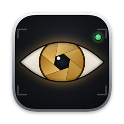
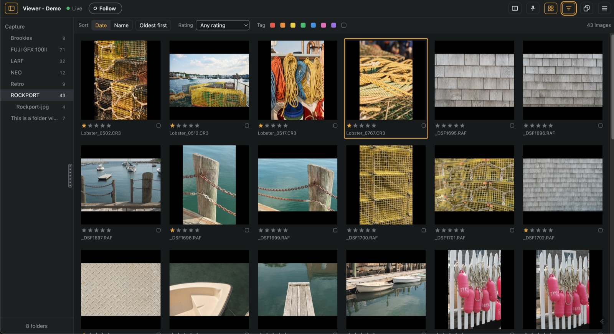
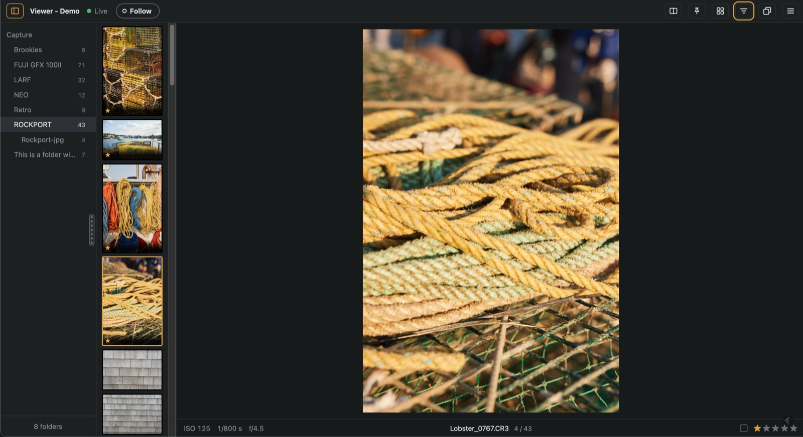
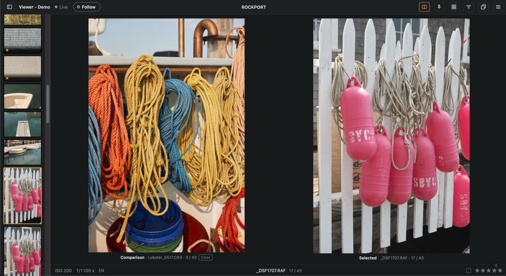
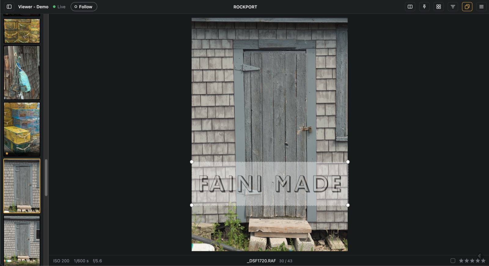
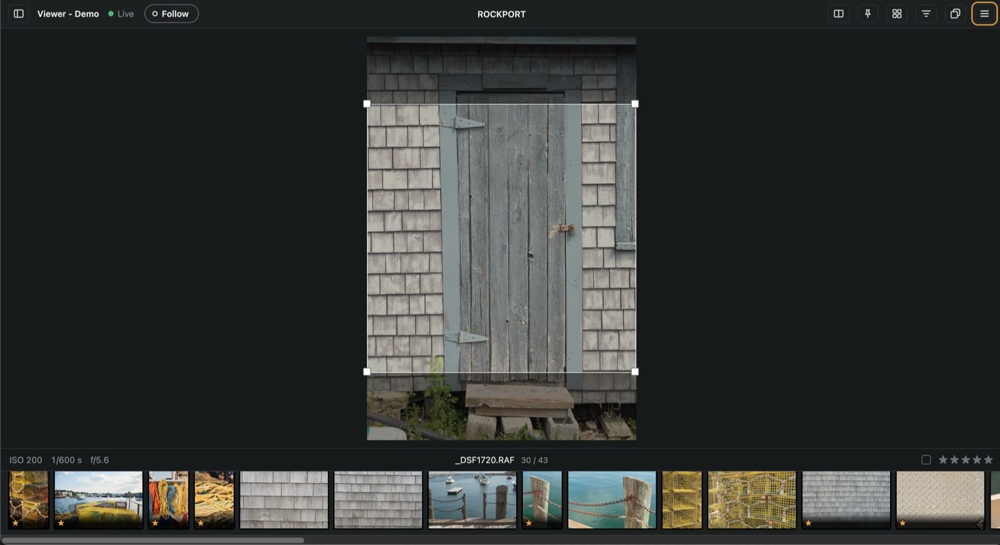
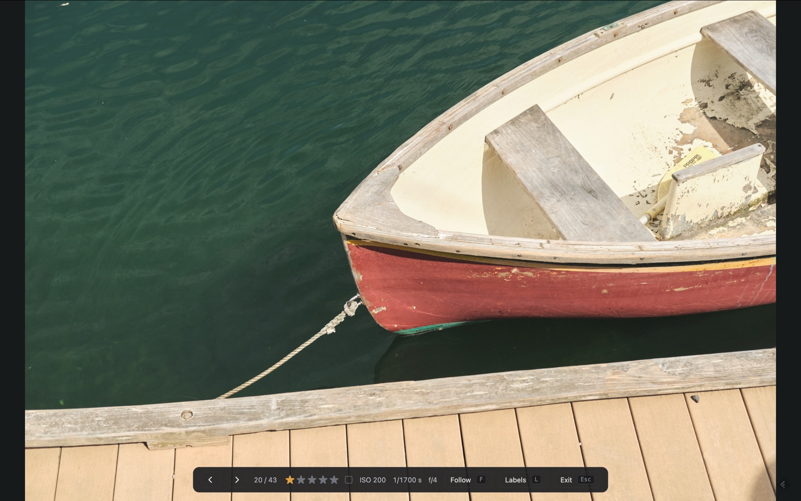

  

<h1 align="center">StudioViewer</h1>

  <strong>See your Capture One shoot live in any web browser, in the studio or anywhere.</strong> 
  A free Mac menu bar app for photographers, digital techs and their clients.

  <a href="https://github.com/titleunknown/StudioViewer/releases/latest">Download</a> ·
  <a href="docs/USER-GUIDE.md">User guide</a> ·
  <a href="PRIVACY.md">Privacy</a> ·
  <a href="#support">Support</a>

  

Capture One's **Live for Studio** shares your session with Capture One's iPad app. StudioViewer
connects to the same feature and shows the shoot in a web browser instead, so the art director's
laptop, the client's phone, the monitor on the wall or someone across the world can follow along
as you shoot: each new capture appears as soon as Capture One has it, ready to zoom in on.

## What it does

- **Live from Capture One.** Your session's folders and photos, updating as you shoot. With
  **Follow** on, the viewer jumps to each new capture, and Capture One's **Trigger Follow** brings
  every open viewer along.
- **Any browser, no app to install.** Phones, tablets and computers on your network open an
  address or scan a QR code. Nothing to install on their side.
- **A proper look at each photo.** Zoom to 100% to check focus, step through with the filmstrip,
  and see the exposure details.
- **Ratings and color tags,** if you allow them: they go straight back into Capture One. Choose
  view only, a PIN, or anyone, and stop or remove any device.
- **Compare** a photo side by side with the one before it, or any photo you pick.
- **Overlays and framing:** lay your layout, logo or template over the photo, or show an
  aspect-ratio frame for the crop.
- **Fullscreen mode** for a client screen: just the photo, with a control bar when you need it.
- **Share outside the studio** at your own address (a domain on a free Cloudflare account) or a
  temporary link that needs no account, protected by a viewing code.
- **Lives in the menu bar:** start and stop, the addresses and QR codes, who's watching, and a
  notification if Capture One stops answering.

<table>
  <tr>
    <td width="50%"></td>
    <td width="50%"></td>
  </tr>
  <tr>
    <td><strong>One photo at a time,</strong> with the filmstrip and exposure details</td>
    <td><strong>Compare</strong> two photos side by side</td>
  </tr>
  <tr>
    <td></td>
    <td></td>
  </tr>
  <tr>
    <td><strong>Overlay</strong> your layout or logo</td>
    <td><strong>Aspect-ratio frame</strong> for the crop</td>
  </tr>
</table>

   
  <strong>Fullscreen mode</strong> for a client monitor

## What you need

- **A Mac with Apple silicon** running macOS 15 or later.
- **Capture One with Live for Studio**, which needs Capture One's Studio edition.
- **For viewers:** any up-to-date web browser on the same network, or anywhere with remote
  sharing.

## Getting started

1. **Download** the latest release from the
   [Releases page](https://github.com/titleunknown/StudioViewer/releases/latest), unzip it and move
   **StudioViewer** to your Applications folder.
2. **In Capture One,** open your session, open the **Live for Studio** tool, choose what to share and
   click **Start Sharing**.
3. **Open StudioViewer.** It appears in the menu bar as an eye and starts the viewer. Open one of
   its addresses, or scan its QR code, on any phone, tablet or computer on your network.

The [user guide](docs/USER-GUIDE.md) covers everything else:
[sharing outside the studio](docs/USER-GUIDE.md#sharing-outside-the-studio-remote-clients),
[fullscreen mode](docs/USER-GUIDE.md#showing-it-to-a-client-fullscreen-mode),
[who can rate and tag](docs/USER-GUIDE.md#who-can-rate-and-tag),
[keyboard shortcuts](docs/USER-GUIDE.md#keyboard-shortcuts-and-touch-gestures) and
[what to do if something goes wrong](docs/USER-GUIDE.md#if-something-goes-wrong).

## Good to know

- StudioViewer is **not made, endorsed or supported by Capture One**. It speaks the same language
  as Capture One's iPad app, which Capture One doesn't document, so a Capture One update can break
  it until StudioViewer catches up. Check for updates in **About**.
- Your photos stay on your Mac. With remote sharing on, they travel to remote viewers through
  Cloudflare. StudioViewer sends nothing to Faini Made; see the [privacy policy](PRIVACY.md).

## For developers

StudioViewer is a SwiftUI menu bar app that runs a Python engine (`studio_viewer.py`) with its own
bundled Python and Cloudflare's `cloudflared`. How it fits together, building it, the engine's
tests and making a release are in [App/README.md](App/README.md).

## Licence

StudioViewer is free software under the [GNU General Public License v3](LICENSE): anyone may use
it, including commercially, and changed versions that are passed on must stay under the same
licence, with their source. It comes with no warranty. © 2026 Faini Made Inc.

## Support

StudioViewer is free. If you find it useful, consider supporting its development:

  

---

  By <a href="https://fainimade.com">Faini Made</a>

